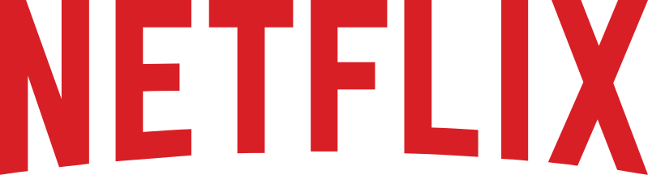
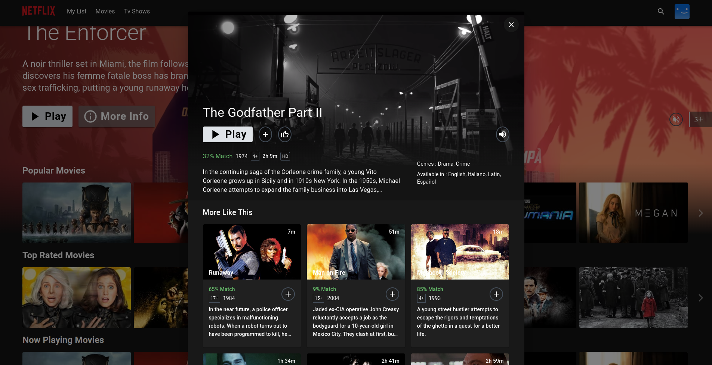
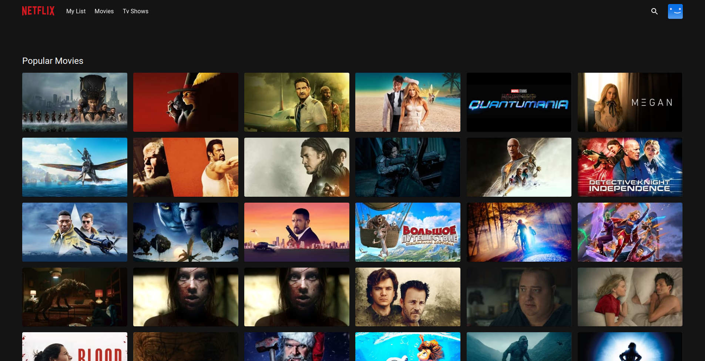

<div align="center">
  

  <h3 align="center">Netflix Clone</h3>

  <p align="center">
    A Netflix-inspired streaming UI built with React, TypeScript, and MUI.<br />
    Data powered by the TMDB API.
  </p>

  <p align="center">
    <a href="https://github.com/mzaddoussi/Netflix-Clone">Repository</a>
    ·
    <a href="https://github.com/mzaddoussi">Author</a>
  </p>
</div>

<details>
  <summary>Table of Contents</summary>
  <ol>
    <li><a href="#getting-started">Getting Started</a></li>
    <li><a href="#features">Features</a></li>
    <li><a href="#tech-stack">Tech Stack</a></li>
    <li><a href="#install-with-docker">Install with Docker</a></li>
    <li><a href="#author">Author</a></li>
  </ol>
</details>

<br />

<div align="center">
  
  <p align="center">Home Page</p>
  
  <p align="center">Mini Portal</p>
  
  <p align="center">Detail Modal</p>
  
  <p align="center">Grid Genre Page</p>
  
  <p align="center">Watch Page with custom control bar</p>
</div>

## Getting Started

### Prerequisites

- Node.js 18+
- A free [TMDB](https://www.themoviedb.org/) account and API key ([docs](https://developers.themoviedb.org/3/getting-started/introduction))

### Setup

```sh
npm install
cp .env.example .env
```

Add your TMDB v3 API key to `.env`:

```env
VITE_APP_API_ENDPOINT_URL=https://api.themoviedb.org/3
VITE_APP_TMDB_V3_API_KEY=your_api_key_here
```

### Run locally

```sh
npm run dev
```

### Build

```sh
npm run build
npm run preview
```

## Features

- Custom React hooks
- Context + providers
- Code-splitting with `lazy` / `Suspense` and React Router lazy routes
- React Router data loaders with Redux dispatch
- Portals and forward refs
- Higher-order components (HOC)
- MUI theme customization
- Redux Toolkit + RTK Query
- Infinite scrolling (Intersection Observer)
- Carousel with react-slick
- Custom video player controls (video.js)

## Tech Stack

- [React](https://react.dev/) + [TypeScript](https://www.typescriptlang.org/)
- [Vite](https://vitejs.dev/)
- [react-router-dom](https://reactrouter.com/)
- [MUI](https://mui.com/)
- [Redux Toolkit](https://redux-toolkit.js.org/)
- [framer-motion](https://www.framer.com/motion/)
- [video.js](https://videojs.com)
- [react-slick](https://react-slick.neostack.com/)

## Install with Docker

```sh
docker build --build-arg TMDB_V3_API_KEY=your_api_key_here -t netflix-clone .

docker run --name netflix-clone-website --rm -d -p 80:80 netflix-clone
```

## Author

**Mostafa Zaddoussi** — [github.com/mzaddoussi](https://github.com/mzaddoussi)
